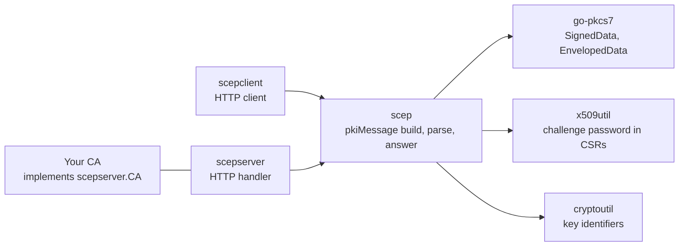
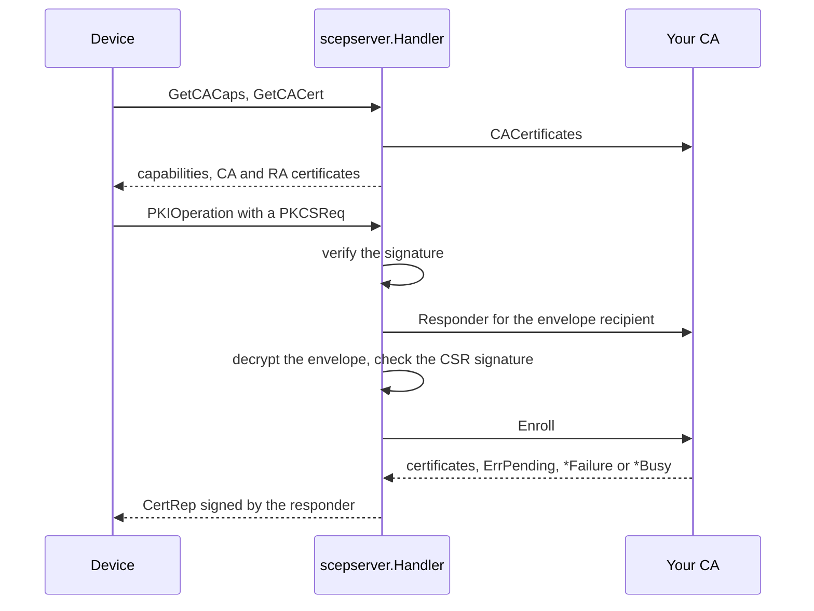

# Architecture

go-pki-scep splits SCEP into a message layer and two HTTP packages built on it. The library owns
the protocol. The code that embeds it owns authorization, issuance and storage.

## Packages

| Package | Role |
| --- | --- |
| `scep` | Builds requests, parses and verifies any pkiMessage, decrypts its content and builds the CertRep answers. It has no transport |
| `scepserver` | Serves the SCEP HTTP operations of one URL and passes verified, decrypted requests to a `CA` you implement |
| `scepclient` | Talks to one SCEP URL: fetches the CA certificates, enrolls, renews, polls, queries and verifies every answer |
| `x509util` | Creates a CSR that carries a challenge password and reads the password back. `crypto/x509` cannot add the password |
| `cryptoutil` | Derives the key identifier that `scep.CSRTransactionID` turns into a transaction ID |

`internal/testca` is the in-memory CA of the tests. It is not part of the API.

## The pkiMessage

Every PKIOperation request and answer is a pkiMessage: a CMS SignedData whose content is an
EnvelopedData, the pkiEnvelope.

| Layer | Requests | CertRep answers |
| --- | --- | --- |
| Signer | The requester. A PKCSReq uses a self-signed certificate for the CSR key, a RenewalReq the certificate being renewed | The CA or its RA |
| Signed attributes | transactionID, messageType and senderNonce | transactionID, messageType, pkiStatus, senderNonce, recipientNonce and, on FAILURE, failInfo |
| pkiEnvelope recipient | The CA or RA certificate from GetCACert | The certificate that signed the request |
| pkiEnvelope content | A CSR, an issuer and subject for CertPoll or an issuer and serial number for GetCert and GetCRL | The certificates or the CRL of a SUCCESS answer. PENDING and FAILURE answers carry none |

The signature covers the encrypted envelope, so the envelope cannot be swapped without breaking
the signature. The recipientNonce of an answer repeats the senderNonce of the request, which ties
the answer to one request.

## A request through the handler

For each PKIOperation the handler:

1. Reads the message from the POST body or the GET `message` parameter, within `MaxMessageBytes`.
2. Parses it and verifies its signature with the certificate it carries. The signature proves that
   the requester holds the signer key. A signing-time attribute, when present, must fall within
   the validity of that certificate.
3. Refuses a CertRep, which is not a request.
4. Asks `CA.Responder` for the identity that the pkiEnvelope is encrypted for.
5. Refuses with badAlg a request whose signer certificate has no RSA key, because the answer could
   not be encrypted for it.
6. Decrypts the pkiEnvelope with the responder key and the accepted ciphers. For an enrollment it
   checks the CSR signature and reads the challenge password.
7. Calls `Enroll`, `Poll`, `GetCert` or `GetCRL` and turns the result into a CertRep, an HTTP 503
   or an HTTP 500.

[Refusals and logging](server/refusals-and-logging.md) lists the answer to each failed step.

## A request through the client

`Enroll`, `Poll`, `GetCert` and `GetCRL` share one path:

1. Fetch the capabilities on first use, cache them and pick POST or GET, the digest and the cipher.
2. Build the request, encrypted for `CACertificates.Recipients` and signed with the requester
   certificate.
3. Send it and retry while the server answers HTTP 503.
4. Parse the answer and verify its signature against `CACertificates.Signers` only.
5. Check that the transaction ID and the recipientNonce match the request.
6. Decrypt the content of a SUCCESS answer with the requester key.

## Concurrency

A `Handler` and a `Client` are safe for concurrent use. The handler calls the CA methods
concurrently, so the CA guards its own state. A client caches the capabilities of its server, so
one client per server URL serves a whole program.
